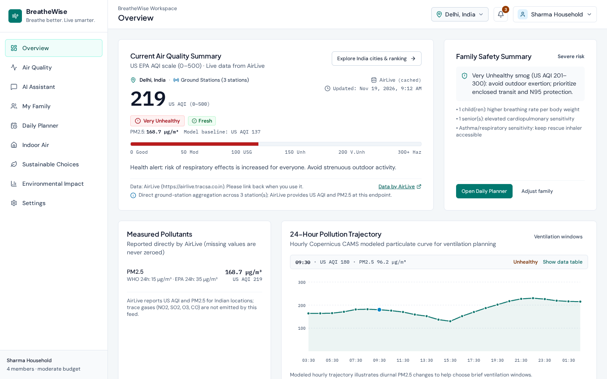
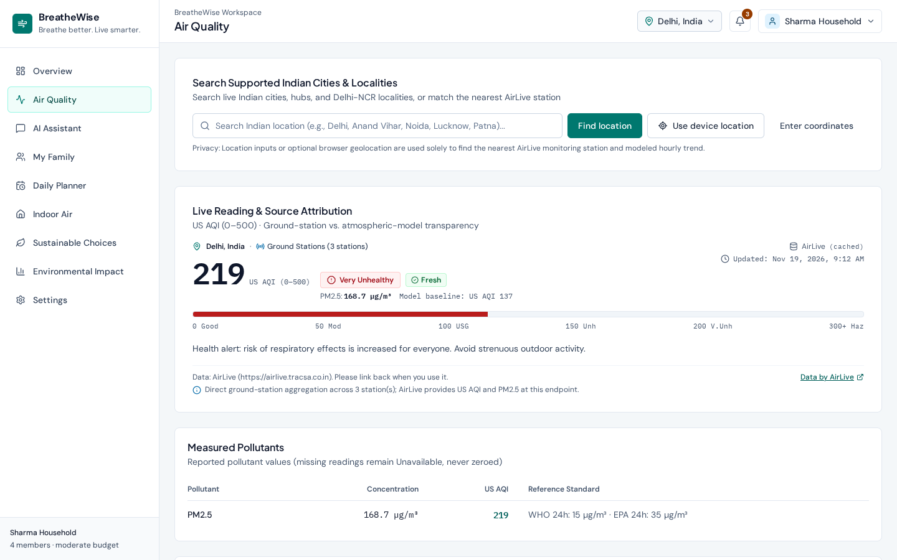
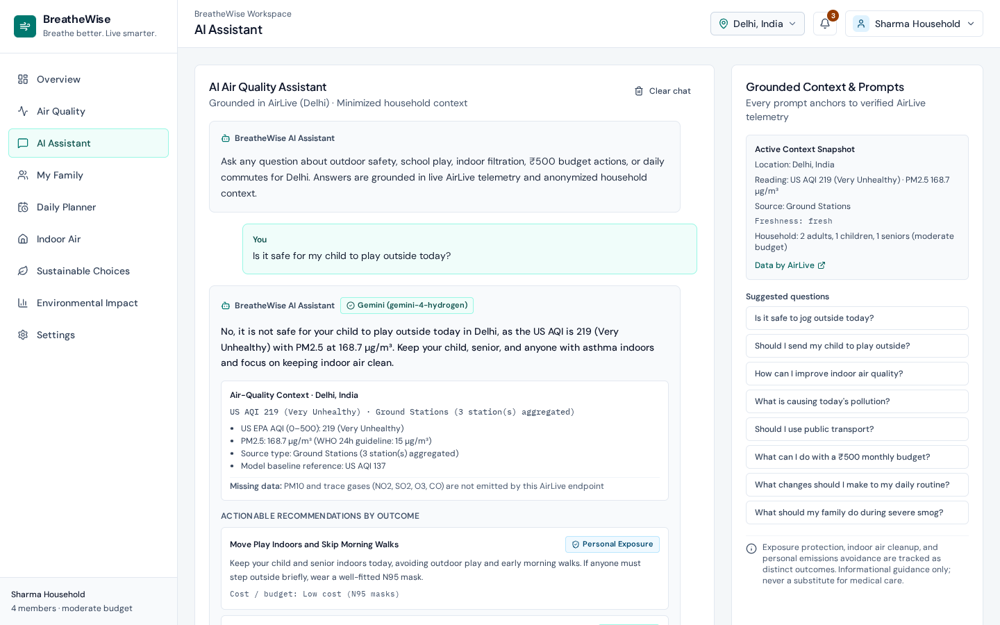
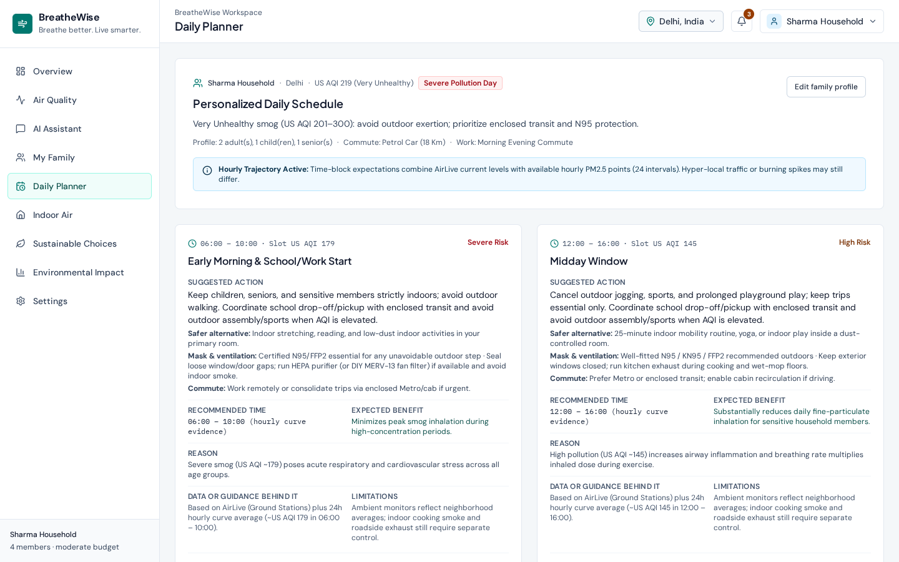
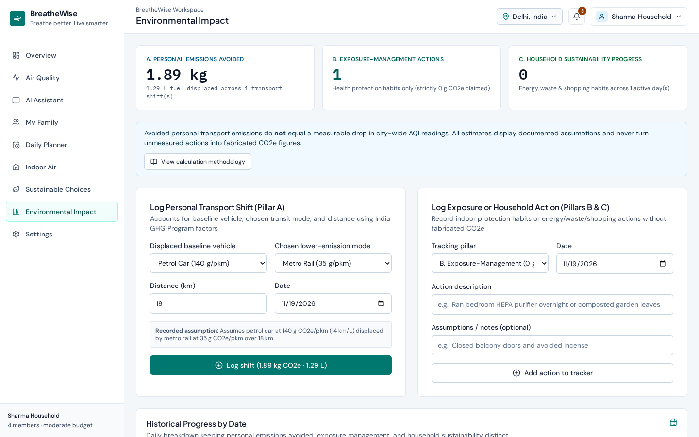
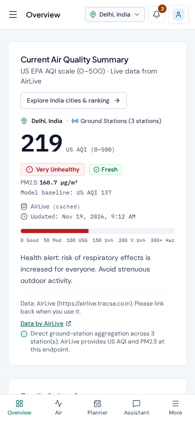

# BreatheWise – Urban Air Quality Assistant

> **Breathe better. Live smarter.**  
> Personalized household air-quality intelligence combining live ground-station telemetry, diurnal pollution trajectories, Google Gemini AI guidance, and transparent sustainability tracking.

---

## 1. Project Introduction

**BreatheWise** is a full-stack climate-health web application built to help urban households—especially families with children, older adults, outdoor workers, students, and daily commuters—translate raw air pollution numbers into safe, practical, budget-aware daily decisions.

Instead of showing an isolated AQI score with vague advice, BreatheWise pairs **live AirLive monitoring telemetry** and **modeled diurnal curves (Open-Meteo / Copernicus CAMS)** with your **household profile** (age groups, asthma sensitivities, commute distance, cooking fuel, and monthly budget) to deliver tailored daily routines, indoor protection steps, and honest environmental impact calculations.

---

## 2. Challenge Statement

**PromptWars Challenge 6 — Urban Air Quality & Sustainable Living Assistant:**  
Build a trustworthy, production-ready environmental intelligence application that helps residents in polluted cities understand real air quality data, make safer daily and indoor health decisions tailored to their household and budget, adopt practical low-emission alternatives, and transparently track personal impact without fabricating measurements or climate claims.

---

## 3. Problem Being Solved

Residents in high-pollution cities across India and worldwide face four recurring gaps in consumer AQI apps:
1. **Unactionable numbers:** Knowing that PM2.5 is `168.7 µg/m³` or US AQI is `219` does not tell parents whether a child with asthma can play outdoors at 4 PM or how to protect a living room on a ₹500 monthly budget.
2. **Scale & source confusion:** Apps routinely mix Indian National AQI (NAQI) with US EPA AQI, disguise modeled grid forecasts as live ground stations, or substitute `0` when trace gases are not reported.
3. **One-size-fits-all privilege bias:** Generic advice ("buy a ₹25,000 HEPA purifier and work from home") fails low-income families, outdoor workers, and households cooking with LPG or solid fuels.
4. **Greenwashing in habit trackers:** Many trackers conflate wearing a mask with cutting carbon emissions or claim personal choices measurably drop city-wide AQI.

---

## 4. Solution Overview

BreatheWise solves these gaps through five integrated pillars:
- **Truthful Live Air Quality Telemetry:** Integrates live **AirLive** (`airlive.tracsa.co.in`, zero API key required) with clear **US EPA AQI (0–500)** scale labels, station counts vs. model baseline transparency, `>3h` staleness detection, and non-zeroed missing pollutants.
- **Grounded Gemini AI Assistant:** Server-side `@google/genai` (`gemini-4-hydrogen`) answers natural-language household questions grounded in live AirLive telemetry and minimized family context, backed by an automatic deterministic `rule_based_fallback`.
- **Personalized Family Planner (Module A):** Builds time-slotted morning, midday, evening, and night plans using hourly diurnal PM2.5 trajectories and household risk factors.
- **Budget-Aware Indoor Air Advisor (Module B):** Computes **5 ACH CADR sizing** for your exact room size, identifies safest brief ventilation windows, and gives actionable steps for cooking smoke, dust, filtration, and ₹0 / ≤₹500 / moderate / flexible budgets.
- **Sustainable Alternatives & 3-Pillar Impact Tracker (Modules C & D):** Recommends realistic low-emission commute/waste/energy switches and keeps **Personal Emissions Avoided (CO₂e & fuel displaced)**, **Exposure-Management Actions (strictly 0 g CO₂e)**, and **Household Sustainability Habits** transparently separated with documented formulas.

---

## 5. Screenshots

### Dashboard Overview & Live Telemetry


### Air Quality Search, Stations & Attribution


### Grounded Gemini AI Assistant


### Personalized Daily Planner


### Transparent Environmental Impact Tracker


### Responsive Mobile Layout (`390×844`)


---

## 6. Feature Descriptions

- **Overview & Air Quality Explorer:** Instant location switching across 280+ AirLive cities/localities, India worst/best rankings, optional click-triggered browser geolocation, manual latitude/longitude lookup, US EPA AQI vs. WHO/EPA PM2.5 benchmarks, and keyboard-accessible 24-hour pollution trajectory with a toggleable data `<table>`.
- **AI Air Quality Assistant:** Natural-language Q&A (`"Is it safe to jog outside today?"`, `"What can I do with a ₹500 monthly budget?"`, `"What should my family do during severe smog?"`) returning structured, outcome-categorized cards (`Personal Exposure`, `Indoor Cleanup`, `Personal Emissions`) with mandatory source citations and prompt-injection defenses.
- **Household Profile (`My Family`):** Configures adult/child/senior counts, respiratory sensitivity, commute mode and distance, work schedule, preferred outdoor hours, and budget tier (`low`, `moderate`, `flexible`). Stored strictly locally in `localStorage` with one-click data wipe.
- **Smart Daily Planner:** Generates time-blocked safety guidance (suggested action, time window, reason, expected benefit, supporting telemetry, and limitations) across severe, moderate, cleaner-air, and missing-data days.
- **Indoor Air Quality Advisor:** Interactive room size CADR calculator (targeting 5 air changes per hour), ventilation window recommendations, cooking exhaust/fuel mitigation (`LPG`, `Induction`, `Solid Fuel`), dust control, and DIY MERV-13 / HEPA maintenance filters calibrated to household budget.
- **Sustainable Choices & Environmental Impact:** Practical transport, home energy, waste, and shopping alternatives plus a 3-pillar log ledger displaying explicit India GHG Program emission factors (`petrol_car: 140 g/pkm`, `metro_rail: 35 g/pkm`, etc.) and methodology modal.

---

## 7. Architecture Diagram

```
+----------------------------------------------------------------------------------+
|                    BROWSER CLIENT (React 19 + Tailwind CSS v4)                   |
|                                                                                  |
|  [Overview] [Air Quality] [AI Assistant] [My Family] [Daily Planner]             |
|  [Indoor Air] [Sustainable Choices] [Environmental Impact] [Settings]            |
|                                                                                  |
|  Domain Engines (src/domain/*): US AQI, NAQI, Planner, Indoor, Impact Math       |
|  Privacy State (src/state/AppStateContext.tsx): localStorage + Wipe/Export       |
+----------------------------------------+-----------------------------------------+
                                         | HTTPS JSON (/api/*)
+----------------------------------------v-----------------------------------------+
|                  NODE.JS v22 + EXPRESS BFF SERVER (server.ts)                    |
|                                                                                  |
|  Middleware: Security Headers (CORS, HSTS, CORP, XFO), Sliding-Window Rate Limit,|
|              Zod Request & Response Validation                                   |
|                                                                                  |
|  Services:   AirQualityService (10m/30m single-flight cache)                     |
|              GeminiAssistantService (@google/genai + rule_based_fallback)        |
+-------------------+--------------------------------------+-----------------------+
                    |                                      |
      +-------------v--------------+         +-------------v-------------+
      | AirLive Public API         |         | Google Gemini API         |
      | airlive.tracsa.co.in       |         | gemini-4-hydrogen         |
      | (No AQI key required)      |         | (Server-side secret only) |
      +----------------------------+         +---------------------------+
      +----------------------------+
      | Open-Meteo / CAMS Global   |
      | Diurnal curve + Geocoding  |
      | (CC BY 4.0, no key)        |
      +----------------------------+
```

---

## 8. Technology Stack

- **Frontend:** React 19, TypeScript 7, Tailwind CSS v4 (`@tailwindcss/vite`), Lucide React, Vite 8 (Rolldown chunk splitting & route-level `React.lazy()`).
- **Backend:** Node.js v22+, Express 4, Zod 4 runtime schema validation, `@google/genai` SDK (`gemini-4-hydrogen`).
- **Live Data & Models:** AirLive API (`https://airlive.tracsa.co.in/`) & Open-Meteo Air Quality / Geocoding APIs (`Copernicus CAMS`, CC BY 4.0).
- **Testing & QA:** Vitest 5, React Testing Library, `jsdom`, `tsc --noEmit`, `playwright-cli` (Headless Chromium).

---

## 9. Setup Instructions

### Prerequisites
- **Node.js v22+** (supports native `node server.ts` execution) and **npm**.

### Local Development
```bash
# 1. Install dependencies
npm install

# 2. Configure environment variables
cp .env.example .env
# Edit .env and add your GEMINI_API_KEY (optional if testing rule-based fallback only)

# 3. Start full-stack dev server (Express API + Vite middleware on port 3000)
npm run dev
```
Open `http://localhost:3000`.

### Production Build & Run Locally
```bash
# Build frontend assets to dist/
npm run build

# Run Express BFF serving dist/ and /api/* natively
NODE_ENV=production node server.ts
```

---

## 10. Environment Variables

Defined in `.env.example` (never commit `.env` or real secrets):

| Variable | Required | Default | Description |
| :--- | :--- | :--- | :--- |
| `GEMINI_API_KEY` | Optional (Recommended) | `null` | Server-side Google Gemini API key. If omitted, `/api/ai/chat` transparently returns structured `rule_based_fallback` guidance. |
| `APP_URL` | Optional | `http://localhost:3000` | Primary origin allowed by CORS in production. |
| `ALLOWED_ORIGINS` | Optional | `""` | Comma-separated extra CORS origins for custom domains/reverse proxies. |
| `PORT` | Optional | `3000` | HTTP server port (`server.ts`). |
| `AQI_CACHE_TTL_MS` | Optional | `600000` | AirLive server cache TTL in ms (enforced minimum `300000` ms = 5 min). |
| `PROVIDER_TIMEOUT_MS` | Optional | `10000` | Upstream HTTP timeout for AirLive / Open-Meteo calls (ms). |
| `GEMINI_TIMEOUT_MS` | Optional | `35000` | Timeout for Gemini structured JSON generation (ms). |

---

## 11. API Configuration

BreatheWise requires **zero AQI API keys**:
- **AirLive (`https://airlive.tracsa.co.in/`):** Uses `/api/v1/aqi`, `/api/v1/aqi/{slug}`, and `/api/v1/ranking` with respectful `>= 10 min` caching and single-flight request deduplication.
- **Open-Meteo (`air-quality-api.open-meteo.com` / `geocoding-api.open-meteo.com`):** Keyless non-commercial API cached for `30 min` for hourly modeled diurnal trends only.
- **Backend Endpoints:** `/api/health`, `/api/air-quality/places`, `/api/air-quality/current`, `/api/air-quality/ranking`, `/api/air-quality/history`, `/api/air-quality/search`, `/api/air-quality/recommendations`, and `/api/ai/chat`. See [docs/API_DESIGN.md](docs/API_DESIGN.md).

---

## 12. Test Commands

```bash
# TypeScript static type check
npm run lint

# Full automated test suite (38 tests: domain + server API/security + React UI)
npm test

# Production Vite build check
npm run build
```

---

## 13. Deployment Instructions

BreatheWise ships with `"start": "node server.ts"` in `package.json`, making it deployable as a unified Node.js full-stack service on **Google Cloud Run**, Railway, Render, or Docker:

```bash
# Build client bundle once during container image build / CI step
npm ci
npm run build

# Start production server on $PORT (default 3000)
NODE_ENV=production npm start
```

### Production Checklist
1. Set `GEMINI_API_KEY`, `NODE_ENV=production`, `APP_URL=https://your-service-url`, and optional `ALLOWED_ORIGINS` in platform secrets/env vars.
2. Verify HTTPS termination forwards `x-forwarded-proto: https` (BreatheWise automatically enables `trust proxy` and emits `Strict-Transport-Security`).
3. Confirm live connectivity with `GET https://your-service-url/api/health`, `GET https://your-service-url/api/air-quality/current?slug=delhi`, and a `POST /api/ai/chat` query.

---

## 14. Limitations

1. **Upstream Trace Gas Availability:** AirLive's city/locality endpoints provide **US EPA AQI** and **PM2.5**; other pollutants (`PM10`, `NO2`, `O3`, `SO2`, `CO`) are shown only when reported and otherwise stay marked `Not reported`.
2. **Modeled vs. Street-Level Hourly Curve:** The 24-hour trajectory uses Copernicus CAMS gridded modeling (~45 km grid) via Open-Meteo to indicate typical diurnal mixing windows; localized traffic or waste-burning spikes can differ.
3. **Client-Only Storage (`localStorage`):** Household profiles and environmental logs remain on the user's device without cloud account sync.
4. **Offline Container `npm audit` Caveat:** In offline build sandboxes without `package-lock.json`, `npm audit` cannot contact the registry; run `npm audit` in CI before public release.

---

## 15. Data Sources & Attribution

- **Live Air Quality Telemetry:** [AirLive](https://airlive.tracsa.co.in/) — US EPA AQI (0–500), PM2.5, ground station counts, and city rankings.
- **Hourly Diurnal Trajectory & Geocoding:** [Open-Meteo](https://open-meteo.com/) using Copernicus Atmosphere Monitoring Service (CAMS) information (CC BY 4.0).
- **AI Synthesis:** Google Gemini API (`@google/genai`, `gemini-4-hydrogen`) restricted to server-side execution.
- **Transport Emission Factors:** India GHG Program / Shakti Sustainable Energy Foundation urban road transport midpoints (`g CO₂e/pkm` and city fuel economy assumptions, documented transparently in the in-app Methodology modal).
